# Product Requirements Document (PRD) & Entity Relationship Diagram (ERD)
## Sistem Manajemen Praktikum Terpadu (LMS Praktikum) — Fullstack Next.js 16 Edition

**Referensi Spesifikasi Asal:** [THERIZKY/projectPraktikum](https://www.google.com/search?q=https%3A%2F%2Fgithub.com%2FTHERIZKY%2FprojectPraktikum)  
**Target Arsitektur Baru:** Fullstack [Next.js 16](https://www.google.com/search?q=https%3A%2F%2Fnextjs.org%2Fblog%2Fnext-16) (App Router) + Tailwind CSS v4 + shadcn/ui + [Auth.js v5](https://www.google.com/search?q=https%3A%2F%2Fauthjs.dev%2Fgetting-started%2Fadapters%2Fprisma) + [Prisma ORM v7](https://www.google.com/search?q=https%3A%2F%2Fwww.prisma.io%2Fdocs%2Fguides%2Fauthentication%2Fauthjs%2Fnextjs) (PostgreSQL) + Supabase Storage  
**Strategi Performa:** Next.js 16 Explicit **Cache Components** (`'use cache'`, `'use cache: private'`, [cacheLife()](https://www.google.com/search?q=https%3A%2F%2Fnextjs.org%2Fdocs%2Fapp%2Fapi-reference%2Ffunctions%2FcacheLife), [cacheTag()](https://www.google.com/search?q=https%3A%2F%2Fnextjs.org%2Fdocs%2Fapp%2Fapi-reference%2Ffunctions%2FcacheTag), `updateTag()`, `revalidateTag()`)

## 1. Ringkasan Eksekutif & Latar Belakang Migrasi

Proyek [THERIZKY/projectPraktikum](https://www.google.com/search?q=https%3A%2F%2Fgithub.com%2FTHERIZKY%2FprojectPraktikum) sebelumnya dibangun menggunakan arsitektur terpisah (*decoupled*) antara backend **ElysiaJS** (di dalam folder `BE/`) dan frontend **Next.js 16.2.12** (di dalam folder `FE/`). Meskipun seluruh aturan bisnis laboratorium sudah matang—mencakup 21 tabel PostgreSQL, 11 enum domain, *multi-version assignment submission*, kalkulasi nilai berbobot dengan 4 metode agregasi sesi, serta ekspor nilai Excel—arsitektur lama memiliki beberapa hambatan utama:

1. **Overhead Komunikasi & Duplikasi Tipe Data**: Frontend harus memelihara *client-side fetching* manual menggunakan Axios, TanStack React Query, dan Zustand untuk berkomunikasi dengan 15 modul endpoint ElysiaJS, sehingga validasi Zod dan definisi tipe harus ditulis berulang di dua repositori/folder.
2. **Manajemen Token Manual**: Autentikasi lama menggunakan `@elysiajs/jwt` dan tabel `RefreshToken` kustom yang dikelola manual via `js-cookie` di sisi klien.
3. **Hierarki UI/UX yang Masih Rata (*Flat Navigation*)**: Di folder `FE/src/app/(dashboard)`, halaman utama seperti `/laboratories`, `/practicums`, `/submissions`, dan `/grades` hanya berupa satu file `page.tsx` tingkat atas tanpa *drill-down layout* per kelas atau per sesi pertemuan, serta belum memanfaatkan sistem komponen aksesibel seperti **shadcn/ui**.
4. **Belum Memanfaatkan Caching Native Next.js 16**: Karena seluruh pengambilan data dilakukan di sisi klien via Axios/React Query, fitur unggulan [Next.js 16 Cache Components](https://www.google.com/search?q=https%3A%2F%2Fnextjs.org%2Fdocs%2Fapp%2Fguides%2Fmigrating-to-cache-components) dan *Partial Prerendering (PPR)* sama sekali belum terpakai.

Dokumen **PRD dan ERD** ini merancang ulang keseluruhan sistem menjadi **Fullstack Next.js 16 Monolith** yang mempertahankan **100% spesifikasi domain dan aturan bisnis** dari `projectPraktikum`, sekaligus menghadirkan desain antarmuka modern berbasis **Tailwind CSS v4 + shadcn/ui**, autentikasi terpusat dengan **Auth.js v5**, dan pemanfaatan **Full Fitur Cache Next.js 16**.

## 2. Perbandingan Arsitektur Lama vs. Arsitektur Baru

| Komponen Arsitektur | Versi Lama (`BE/` Elysia + `FE/` Next.js) | Versi Baru (Fullstack Next.js 16) | Keuntungan Utama Migrasi |
| :--- | :--- | :--- | :--- |
| **Runtime & Framework** | Terpisah: ElysiaJS (Bun) + Next.js 16.2.12 | Monolith Fullstack [Next.js 16](https://www.google.com/search?q=https%3A%2F%2Fnextjs.org%2Fblog%2Fnext-16) (App Router + Turbopack + React Compiler) | Satu *codebase*, *zero API boilerplate* untuk pembacaan data, *type-safety* langsung dari database ke UI. |
| **Komunikasi Data & Mutasi** | REST API (`Axios` + `@tanstack/react-query`) | **React Server Components (RSC)** untuk *read* + **Server Actions** untuk *mutation* + **Route Handlers** untuk unduhan file/Excel | Eliminasi *client waterfall*, *bundle size* JS klien jauh lebih kecil, dan integrasi langsung dengan `updateTag()`. |
| **Sistem Autentikasi** | Custom JWT (`@elysiajs/jwt`) + tabel `RefreshToken` + `js-cookie` | **[Auth.js v5 (NextAuth v5)](https://www.google.com/search?q=https%3A%2F%2Fauthjs.dev%2Fgetting-started%2Fadapters%2Fprisma)** + `@auth/prisma-adapter` + `proxy.ts` Next.js 16 | Mendukung Credentials (NIM/Username) sekaligus OAuth (Google Kampus), *HttpOnly cookie* otomatis, dan proteksi sesi di server. |
| **Sistem Caching** | Client-side memory cache (React Query) | **Next.js 16 Cache Components** (`cacheComponents: true`, `'use cache'`, [cacheLife](https://www.google.com/search?q=https%3A%2F%2Fnextjs.org%2Fdocs%2Fapp%2Fapi-reference%2Ffunctions%2FcacheLife), [cacheTag](https://www.google.com/search?q=https%3A%2F%2Fnextjs.org%2Fdocs%2Fapp%2Fapi-reference%2Ffunctions%2FcacheTag)) | Navigasi instan (*Instant Navigation*), beban query PostgreSQL turun drastis, dan invalidasi presisi per entitas. |
| **UI & Komponen Desain** | Custom Tailwind CSS v4 tanpa library komponen terpadu | **Tailwind CSS v4 + shadcn/ui** + `@tanstack/react-table` + `Recharts` + `Sonner` + `Lucide React` | Konsistensi visual setara produk SaaS modern, mendukung *Dark/Light Mode*, *keyboard navigation* (`⌘K`), dan *inline grading table*. |
| **Database & File Storage** | PostgreSQL (`Prisma v7.9.1`) + Supabase Storage + `ExcelJS` | Tetap PostgreSQL (`Prisma v7.9.1` + `@prisma/adapter-pg`) + Supabase Storage + `ExcelJS` | Skema data dan logika bisnis 100% kompatibel tanpa kehilangan fitur yang sudah berjalan. |

## 3. Product Requirements Document (PRD)

### 3.1 Peran Pengguna & Matriks Hak Akses (RBAC)

Sistem mempertahankan **4 peran pengguna (`UserRole`)** sesuai skema asli [THERIZKY/projectPraktikum](https://www.google.com/search?q=https%3A%2F%2Fgithub.com%2FTHERIZKY%2FprojectPraktikum):

1. **`SYSTEM_ADMIN` (Administrator Sistem)**: Pengelola tertinggi tingkat fakultas/departemen yang mengatur seluruh akun pengguna, daftar laboratorium, pengaturan global (`SystemSetting`), dan memantau `AuditLog`.
2. **`LAB_ADMIN` (Kepala / Admin Laboratorium)**: Pengelola laboratorium spesifik yang membuka mata praktikum per semester, mengatur komponen penilaian & konversi nilai huruf, membuka kelas/shift, menugaskan asisten, serta mempublikasikan nilai akhir (`PublishedGrade`).
3. **`ASSISTANT` (Asisten Praktikum / Asprak)**: Pengampu kelas praktikum yang mengelola sesi pertemuan, mengunggah modul/materi (`SessionMaterial`), mencatat presensi (`Attendance`), membuat tugas (`Assignment`), me-review *versioned submission* mahasiswa, dan menginput nilai per sesi/komponen (`Grade`).
4. **`STUDENT` (Praktikan / Mahasiswa)**: Peserta praktikum yang terdaftar pada kelas (`StudentEnrollment`), mengunduh materi sesi, melihat presensi, mengunggah tugas beserta revisinya (`SubmissionVersion`), dan melihat rincian nilai maupun nilai akhir yang dipublikasikan.

| Modul / Fitur Utama | `SYSTEM_ADMIN` | `LAB_ADMIN` | `ASSISTANT` | `STUDENT` |
| :--- | :--- | :--- | :--- | :--- |
| **Dashboard Analitik Role-Specific** | Global System Stats & 10 Audit Log terbaru | Statistik Lab, Praktikum, Asisten & Pending Submissions | Kelas Diampu, Jadwal Sesi & Antrean Review Tugas | Praktikum Aktif, Tenggat Tugas & Nilai Publikasi |
| **Manajemen User (`users`)** | Full CRUD, Aktivasi Akun, Ubah Role, Import Excel | Lihat daftar Asisten & Mahasiswa di Lab-nya | Lihat daftar Praktikan di kelas yang diampu | Lihat & ubah profil pribadi (`/profile`) |
| **Manajemen Laboratorium (`laboratories`)** | Full CRUD Lab & Penunjukan `LAB_ADMIN` | Edit informasi Lab yang dikelola | Hanya Baca (Read-only) | Hanya Baca (Read-only) |
| **Manajemen Praktikum (`practicums`)** | Full CRUD lintas Lab | Full CRUD Praktikum di Lab-nya | Hanya Baca (Read-only) | Hanya Baca (Read-only) |
| **Skema Nilai (`grading_components` & `grade_letter_mappings`)** | Full Akses | Konfigurasi bobot komponen, metode agregasi & rentang huruf mutu | Hanya Baca (Read-only) | Hanya Baca (Read-only) |
| **Kelas, Enrollment & Penugasan Asisten** | Full Akses | Buat Kelas/Shift, Kelola Enrollment Praktikan & Assign Asisten | Lihat daftar anggota kelas yang diampu | Lihat kelas tempat dirinya terdaftar |
| **Sesi Pertemuan & Materi (`sessions` & `session_materials`)** | Full Akses | Full CRUD Sesi & Materi di Lab-nya | Kelola status sesi (`IN_PROGRESS`, `COMPLETED`) & Unggah Materi | Unduh materi modul per sesi (*Signed URL*) |
| **Presensi Praktikum (`attendances`)** | Lihat Rekap | Lihat & Koreksi Presensi Lab | Input & Update Presensi (`PRESENT`, `ABSENT`, `LATE`, `EXCUSED`) | Lihat riwayat kehadiran sendiri |
| **Tugas & Submission Ber-versi (`assignments`, `submissions`)** | Lihat Semua | Buat Tugas Praktikum & Pantau Pengumpulan | Buat Tugas Sesi, Review Submission (`ACCEPTED`, `REVISION_REQUESTED`, `REJECTED`) | Unggah File Tugas & Revisi (`v1`, `v2`, dst.) + Catatan Revisi |
| **Penilaian & Publikasi Nilai (`grades`, `published_grades`)** | Lihat Semua | Hitung Otomatis, Review & **Publish Final Grade** | Input & Edit Nilai per Sesi / Komponen (`Grade`) | Lihat nilai komponen & nilai akhir yang sudah di-publish |
| **Ekspor Nilai Excel (`ExcelJS`)** | Unduh `.xlsx` semua praktikum | Unduh `.xlsx` praktikum di Lab-nya | Unduh `.xlsx` kelas yang diampu | Tidak Memiliki Akses |
| **Pengumuman & Notifikasi (`announcements`, `notifications`)** | Buat Pengumuman Sistem/Lab | Buat Pengumuman Lab/Praktikum & Pin | Buat Pengumuman Praktikum | Baca Pengumuman & Kelola Notifikasi Pribadi |
| **Audit Log & System Settings (`audit_logs`, `system_settings`)** | Full Akses Baca Audit Log & Edit Settings | Tidak Memiliki Akses | Tidak Memiliki Akses | Tidak Memiliki Akses |

### 3.2 Spesifikasi Fungsional & Aturan Bisnis (15 Modul Inti)

#### Modul 1: Autentikasi & Manajemen Sesi ([Auth.js v5](https://www.google.com/search?q=https%3A%2F%2Fauthjs.dev%2Fgetting-started%2Fadapters%2Fprisma))
* **Kebutuhan Fungsional**:
  * Pengguna dapat login menggunakan kombinasi `username` atau `nim` atau `email` beserta password (`CredentialsProvider` dengan verifikasi `bcryptjs`), maupun menggunakan SSO Google Kampus (`GoogleProvider`) jika email tertaut.
  * Sistem memeriksa status `isActive` pada tabel `User`; akun yang dinonaktifkan (`isActive = false`) ditolak saat login dengan pesan error yang jelas.
  * Setiap login sukses memperbarui kolom `lastLoginAt` dan mencatat aktivitas ke `AuditLog`.
  * File `src/proxy.ts` (konvensi middleware baru di [Next.js 16](https://www.google.com/search?q=https%3A%2F%2Fnextjs.org%2Fblog%2Fnext-16)) memvalidasi sesi secara ringan dan mengarahkan pengguna yang belum login ke `/login` atau menampilkan halaman `forbidden.tsx` / `unauthorized.tsx` sesuai role.

#### Modul 2: Manajemen Pengguna & Profil (`user` & `profile`)
* **Kebutuhan Fungsional**:
  * `SYSTEM_ADMIN` dapat membuat, memfilter (berdasarkan `role`, status aktif, pencarian `fullName`/`nim`/`username`), mengubah role, dan menonaktifkan pengguna.
  * Mendukung fitur *Bulk Import* mahasiswa dari file `.xlsx`/`.csv` menggunakan `ExcelJS` di Server Action.
  * Setiap pengguna dapat memperbarui profil mandiri (`fullName`, `email`, `phone`, `avatarUrl` via Supabase Storage, dan ganti password).

#### Modul 3: Manajemen Laboratorium (`laboratory`)
* **Kebutuhan Fungsional**:
  * Menyimpan entitas laboratorium dengan `code` unik (contoh: `LAB-RPL`, `LAB-JARKOM`), nama, deskripsi, status aktif, dan menunjuk satu `User` ber-role `LAB_ADMIN` sebagai penanggung jawab (`adminId`).

#### Modul 4: Manajemen Praktikum & Skema Penilaian (`practicum`)
* **Kebutuhan Fungsional**:
  * Setiap laboratorium menaungi banyak mata praktikum (`Practicum`) yang dibedakan menurut `code`, `academicYear` (contoh: `"2026/2027"`), `semester` (`ODD` / `EVEN`), dan `totalSessions` (jumlah pertemuan, default 8–14 sesi).
  * `LAB_ADMIN` mendefinisikan komponen penilaian (`GradingComponent`) per praktikum:
    * `name` (contoh: *Pre-Test*, *Laporan Mingguan*, *Keaktifan Sesi*, *Ujian Akhir Praktikum / Responsi*).
    * `weight` (bobot desimal atau persentase, total seluruh komponen dalam satu praktikum harus bernilai $1.0$ atau $100\%$).
    * `isPerSession` (`true` jika dinilai berulang di setiap sesi pertemuan, `false` jika dinilai satu kali di tingkat praktikum seperti Responsi/Final Project).
    * `aggregationMethod`: Metode agregasi untuk komponen `isPerSession = true`, yaitu `AVERAGE` (rata-rata seluruh sesi), `SUM` (akumulasi), `HIGHEST` (nilai tertinggi), atau `LATEST` (nilai sesi terakhir).
  * `LAB_ADMIN` mendefinisikan tabel konversi nilai huruf (`GradeLetterMapping`), misalnya `A` ($85.00 - 100.00$, bobot $4.00$), `AB` ($80.00 - 84.99$, bobot $3.50$), `B` ($75.00 - 79.99$, bobot $3.00$), dst.

#### Modul 5: Manajemen Kelas, Enrollment Praktikan & Asisten (`class`)
* **Kebutuhan Fungsional**:
  * Setiap praktikum dibagi menjadi beberapa kelas/shift (`PracticumClass`), misalnya `Kelas A - Senin Pagi`, dengan atribut `scheduleDay`, `scheduleTime`, `room`, dan kuota `maxStudents`.
  * Pendaftaran mahasiswa ke kelas disimpan di `StudentEnrollment` dengan constraint unik `@@unique([studentId, practicumClassId])` dan status `ACTIVE`, `DROPPED`, atau `COMPLETED`. Validasi Server Action mencegah penambahan mahasiswa jika jumlah enrollment `ACTIVE` sudah mencapai `maxStudents`.
  * Penugasan asisten disimpan di `AssistantAssignment` dengan constraint unik `@@unique([assistantId, practicumClassId])`.

#### Modul 6: Sesi Pertemuan & Modul Materi (`session`)
* **Kebutuhan Fungsional**:
  * Saat kelas praktikum dibuat (atau melalui tombol *Generate Sessions*), sistem dapat membuat daftar pertemuan (`Session`) dari `sessionNumber = 1` hingga `totalSessions`, lengkap dengan tanggal (`date`), `startTime`, `endTime`, dan status (`SCHEDULED`, `IN_PROGRESS`, `COMPLETED`, `CANCELLED`).
  * Asisten atau Admin Lab dapat mengunggah file modul/materi (`SessionMaterial`) ke Supabase Storage dan menyimpannya beserta metadata (`fileName`, `filePath`, `fileSize`, `mimeType`, `uploadedById`). Unduhan materi oleh mahasiswa menggunakan *signed URL* berbatas waktu.

#### Modul 7: Presensi Pertemuan (`attendance`)
* **Kebutuhan Fungsional**:
  * Pada setiap `Session`, asisten mencatat kehadiran seluruh praktikan yang terdaftar di kelas tersebut (`Attendance`) dengan pilihan status `PRESENT`, `ABSENT`, `LATE`, atau `EXCUSED`.
  * Tersedia fitur **Bulk Mark Present** (tandai hadir semua praktikan sekaligus lalu ubah yang absen/izin) untuk mempercepat kerja asisten di laboratorium.

#### Modul 8: Manajemen Tugas & Versioning Pengumpulan (`submission`)
* **Kebutuhan Fungsional & Aturan Bisnis**:
  * Tugas (`Assignment`) dapat dibuat di tingkat praktikum maupun terikat ke sesi tertentu (`sessionId`), dengan tipe `LAB_REPORT`, `FINAL_REPORT`, `COMPREHENSIVE_REPORT`, `PROJECT`, `QUIZ`, atau `OTHER`.
  * Aturan keterlambatan dikonfigurasi per tugas melalui `deadline`, `latePenaltyPercentage`, `latePenaltyUnit` (`PER_HOUR`, `PER_DAY`, `FLAT`), dan `maxLatePenalty`.
  * **Sistem Multi-Version Submission**:
    * Ketika praktikan mengunggah file tugas untuk pertama kali, sistem membuat record `Submission` dan `SubmissionVersion` dengan `versionNumber = 1`.
    * Jika waktu unggah melewati `deadline`, status `Submission` otomatis diset menjadi `LATE` (jika sebelum deadline diset `SUBMITTED`).
    * Ketika asisten memeriksa tugas dan mengubah status menjadi `REVISION_REQUESTED` disertai `reviewNotes`, praktikan dapat mengunggah file perbaikan yang otomatis tercatat sebagai `SubmissionVersion` baru (`versionNumber = 2, 3, ...`) tanpa menghapus file versi sebelumnya.
    * Path penyimpanan di Supabase Storage mengikuti pola: `submissions/${practicumId}/${assignmentId}/${studentId}/v${versionNumber}_${fileName}`.

#### Modul 9: Kalkulasi Nilai & Publikasi (`grading`)
* **Kebutuhan Fungsional & Rumus Kalkulasi**:
  * Asisten menginput nilai (`Grade`) untuk setiap mahasiswa per `GradingComponent` (dan per `sessionId` apabila `isPerSession = true`), dilengkapi `score` dan `feedback`.
  * **Kalkulasi Nilai Akhir Otomatis**:
    1. Untuk setiap komponen penilaian $i$:
       * Jika `isPerSession == true`, kumpulkan seluruh skor sesi mahasiswa pada komponen tersebut, lalu hitung $\text{rawScore}_i$ menggunakan `aggregationMethod` (`AVERAGE`, `SUM`, `HIGHEST`, atau `LATEST`).
       * Jika `isPerSession == false`, ambil $\text{rawScore}_i$ langsung dari skor komponen tersebut.
    2. Hitung kontribusi nilai terbobot komponen $i$:
       $$\text{weightedScore}_i = \left(\frac{\text{rawScore}_i}{\text{maxScore}_i}\right) \times \text{weight}_i \times 100$$
    3. Jumlahkan seluruh $\text{weightedScore}_i$ menjadi `finalScore` (dibulatkan 2 angka di belakang koma).
    4. Cocokkan `finalScore` dengan rentang `minScore` $\le \text{finalScore} \le$ `maxScore` pada tabel `GradeLetterMapping` untuk mendapatkan `letterGrade` dan `gradePoint`.
  * Saat `LAB_ADMIN` menekan tombol **Publish Grades**, hasil kalkulasi disimpan/diperbarui ke tabel `PublishedGrade` dan memicu pengiriman `Notification` bertipe `GRADE` ke seluruh mahasiswa terkait.

#### Modul 10–15: Pengumuman, Notifikasi, Dashboard, Ekspor Excel, Audit Log & Pengaturan
* **Pengumuman (`Announcement`)**: Mendukung pengumuman global laboratorium (`laboratoryId`) atau spesifik praktikum (`practicumId`), level prioritas (`LOW`, `NORMAL`, `HIGH`, `URGENT`), dan penyematan di bagian atas (`isPinned`).
* **Notifikasi (`Notification`)**: Panel lonceng notifikasi di topbar dengan indikator *unread badge*, filter belum dibaca, dan aksi *Mark All as Read*.
* **Ekspor Nilai (`Export`)**: Route Handler `GET /api/practicums/[id]/export/grades` menggunakan `ExcelJS` untuk menghasilkan file `.xlsx` rapi dengan *header* berwarna, daftar NIM, Nama, Kelas, nilai tiap komponen, nilai akhir, dan nilai huruf.
* **Audit Log (`AuditLog`) & System Setting (`SystemSetting`)**: Mencatat jejak perubahan data sensitif (`oldValues` dan `newValues` berformat JSONB) secara otomatis di dalam *Server Actions* melalui fungsi *helper* `recordAuditLog()`.

## 4. Arsitektur Full Fitur Cache Next.js 16

Sesuai permintaan, proyek baru ini memanfaatkan **seluruh kapabilitas caching terbaru di [Next.js 16](https://www.google.com/search?q=https%3A%2F%2Fnextjs.org%2Fblog%2Fnext-16)** melalui fitur **Cache Components** (`cacheComponents: true`). Di Next.js 16, caching tidak lagi bersifat implisit yang membingungkan, melainkan dikendalikan secara eksplisit menggunakan direktif `'use cache'`, [cacheLife()](https://www.google.com/search?q=https%3A%2F%2Fnextjs.org%2Fdocs%2Fapp%2Fapi-reference%2Ffunctions%2FcacheLife), dan [cacheTag()](https://www.google.com/search?q=https%3A%2F%2Fnextjs.org%2Fdocs%2Fapp%2Fapi-reference%2Ffunctions%2FcacheTag).

### 4.1 Konfigurasi `next.config.ts` dengan Custom Cache Profiles

Kita mendefinisikan profil [cacheLife](https://www.google.com/search?q=https%3A%2F%2Fnextjs.org%2Fdocs%2Fapp%2Fapi-reference%2Ffunctions%2FcacheLife) khusus yang disesuaikan dengan ritme akademik praktikum di `next.config.ts`:

```typescript
// next.config.ts
import type { NextConfig } from 'next'

const nextConfig: NextConfig = {
  // Mengaktifkan fitur Cache Components & Partial Prerendering (PPR) Next.js 16
  cacheComponents: true,
  reactCompiler: true,

  // Profil durasi cache khusus domain LMS Praktikum
  cacheLife: {
    // Data referensi semester & konfigurasi sistem (jarang berubah)
    semester_static: {
      stale: 60 * 30,          // 30 menit di client router cache
      revalidate: 60 * 60 * 24, // 24 jam background revalidation di server
      expire: 60 * 60 * 24 * 30 // 30 hari maksimal
    },
    // Katalog laboratorium, praktikum, komponen nilai & modul materi
    practicum_catalog: {
      stale: 60 * 5,           // 5 menit di client cache (navigasi instan)
      revalidate: 60 * 60,     // 1 jam di server
      expire: 60 * 60 * 24     // 24 jam maksimal
    },
    // Jadwal kelas, sesi pertemuan & pengumuman aktif
    session_schedule: {
      stale: 60 * 2,           // 2 menit di client cache
      revalidate: 60 * 15,     // 15 menit di server
      expire: 60 * 60 * 4      // 4 jam maksimal
    },
    // Statistik dashboard, progres nilai & status submission
    dashboard_stats: {
      stale: 60,               // 1 menit di client cache
      revalidate: 60 * 5,      // 5 menit di server
      expire: 60 * 30          // 30 menit maksimal
    }
  }
}

export default nextConfig
```

### 4.2 Matriks Strategi Caching & Invalidasi per Modul Domain

Berikut adalah pemetaan lengkap penggunaan direktif cache, profil [cacheLife](https://www.google.com/search?q=https%3A%2F%2Fnextjs.org%2Fdocs%2Fapp%2Fapi-reference%2Ffunctions%2FcacheLife), penamaan [cacheTag](https://www.google.com/search?q=https%3A%2F%2Fnextjs.org%2Fdocs%2Fapp%2Fapi-reference%2Ffunctions%2FcacheTag), dan fungsi invalidasi (`updateTag` vs `revalidateTag`) di seluruh aplikasi:

| Modul / Query Data | Direktif Cache | Profil `cacheLife` | Skema `cacheTag()` | Mutasi Pemicu Invalidasi (Server Action) | Fungsi Invalidasi yang Dipakai |
| :--- | :--- | :--- | :--- | :--- | :--- |
| **Daftar & Detail Laboratorium** | `'use cache'` | `'practicum_catalog'` | `'labs'`, `'lab-${labId}'` | Create/Update/Delete Lab | `updateTag('labs')`, `updateTag('lab-${labId}')` |
| **Katalog Praktikum & Skema Nilai** | `'use cache'` | `'practicum_catalog'` | `'practicums'`, `'practicum-${id}'`, `'grading-schema-${id}'` | Update Praktikum, Bobot Komponen, atau Huruf Mutu | `updateTag('practicum-${id}')`, `updateTag('grading-schema-${id}')` |
| **Daftar Kelas & Kuota Shift** | `'use cache'` | `'session_schedule'` | `'classes-${practicumId}'`, `'class-${classId}'` | Enroll Mahasiswa, Assign Asisten, Ubah Jadwal Kelas | `updateTag('class-${classId}')`, `revalidateTag('classes-${practicumId}', 'max')` |
| **Daftar Sesi & Materi Modul** | `'use cache'` | `'session_schedule'` | `'sessions-${classId}'`, `'session-${sessionId}'`, `'materials-${sessionId}'` | Unggah/Hapus Modul Materi, Ubah Status Sesi | `updateTag('materials-${sessionId}')`, `updateTag('session-${sessionId}')` |
| **Daftar Pengumuman Lab/Praktikum** | `'use cache'` | `'session_schedule'` | `'announcements'`, `'announcements-lab-${labId}'` | Publish / Pin / Hapus Pengumuman | `revalidateTag('announcements', 'max')`, `updateTag('announcements-lab-${labId}')` |
| **Dashboard Mahasiswa (Per User)** | `'use cache: private'` | `'dashboard_stats'` | `'student-dashboard-${userId}'`, `'enrollments-${userId}'` | Mahasiswa Submit Tugas / Admin Publish Nilai | `updateTag('student-dashboard-${userId}')` |
| **Detail Submission & Riwayat Versi** | `'use cache: private'` | `'dashboard_stats'` | `'submission-${submissionId}'`, `'submissions-assignment-${assignmentId}'` | Mahasiswa Unggah Revisi `v2` / Asisten Input Review | `updateTag('submission-${submissionId}')`, `updateTag('submissions-assignment-${assignmentId}')` |
| **Tabel Rekap Presensi & Nilai Kelas** | `'use cache'` | `'dashboard_stats'` | `'attendance-session-${sessionId}'`, `'grades-class-${classId}'` | Asisten Simpan Presensi / Input Skor Komponen | `updateTag('attendance-session-${sessionId}')`, `updateTag('grades-class-${classId}')` |
| **Pengaturan Sistem (`SystemSetting`)** | `'use cache'` | `'semester_static'` | `'system-settings'` | System Admin Ubah Pengaturan Global | `updateTag('system-settings')` |
| **Notifikasi Lonceng & Audit Log** | Dynamic (Streaming `<Suspense>`) | `'seconds'` / Dynamic | `'notifications-${userId}'` | Mark Notification as Read | `updateTag('notifications-${userId}')` |

### 4.3 Pola Implementasi Kode Caching & Invalidasi (`updateTag` vs `revalidateTag`)

Sesuai dokumentasi resmi [cacheTag Next.js 16](https://www.google.com/search?q=https%3A%2F%2Fnextjs.org%2Fdocs%2Fapp%2Fapi-reference%2Ffunctions%2FcacheTag):
* Gunakan **`updateTag(tag)`** di dalam *Server Actions* ketika pengguna melakukan aksi mutasi form (seperti asisten menginput nilai atau praktikan mengunggah revisi laporan) agar pengguna tersebut langsung melihat data terbaru secara instan (*read-your-own-writes*) dan *Client Router Cache* langsung dibersihkan.
* Gunakan **`revalidateTag(tag, 'max')`** untuk menyegarkan data bersama di latar belakang (*stale-while-revalidate*) tanpa memblokir respons pengguna lain.

```typescript
// src/server/queries/practicum.queries.ts
import { cacheLife, cacheTag } from 'next/cache'
import { prisma } from '@/lib/prisma'

export async function getPracticumWithSchema(practicumId: string) {
  'use cache'
  cacheLife('practicum_catalog')
  cacheTag('practicums', `practicum-${practicumId}`, `grading-schema-${practicumId}`)

  return prisma.practicum.findUnique({
    where: { id: practicumId },
    include: {
      laboratory: { select: { id: true, name: true, code: true } },
      gradingComponents: { orderBy: { order: 'asc' } },
      gradeLetters: { orderBy: { order: 'asc' } },
      classes: {
        where: { isActive: true },
        include: {
          _count: { select: { studentEnrollments: true, assistantAssignments: true } }
        }
      }
    }
  })
}
```

```typescript
// src/server/actions/submission.actions.ts
'use server'

import { updateTag, revalidateTag } from 'next/cache'
import { auth } from '@/lib/auth'
import { prisma } from '@/lib/prisma'

export async function reviewSubmissionAction(formData: {
  submissionId: string
  assignmentId: string
  status: 'ACCEPTED' | 'REVISION_REQUESTED' | 'REJECTED'
  reviewNotes: string
}) {
  const session = await auth()
  if (!session?.user || !['ASSISTANT', 'LAB_ADMIN', 'SYSTEM_ADMIN'].includes(session.user.role)) {
    throw new Error('Unauthorized')
  }

  const updated = await prisma.submission.update({
    where: { id: formData.submissionId },
    data: {
      status: formData.status,
      reviewNotes: formData.reviewNotes,
      reviewedBy: session.user.id,
      reviewedAt: new Date()
    },
    include: { studentEnrollment: true }
  })

  // Read-your-own-writes: asisten langsung melihat perubahan status detik itu juga
  updateTag(`submission-${formData.submissionId}`)
  updateTag(`submissions-assignment-${formData.assignmentId}`)

  // Revalidasi dashboard mahasiswa pemilik tugas di latar belakang
  revalidateTag(`student-dashboard-${updated.studentEnrollment.studentId}`, 'max')

  return { success: true, data: updated }
}
```

## 5. Spesifikasi Redesign UI/UX (Tailwind CSS v4 + shadcn/ui)

Untuk mengatasi tampilan versi lama yang terasa kaku dan rata (*flat*), redesign di proyek baru ini mengusung konsep **Modern Academic Workspace** (terinspirasi dari Linear, Vercel Dashboard, dan Notion) menggunakan **Tailwind CSS v4** dan komponen **shadcn/ui**.

### 5.1 Hirarki Navigasi Baru (App Router Nested Routes)

Tidak lagi menumpuk semuanya di satu halaman datar, struktur URL dan halaman di `src/app/` dirancang berjenjang (*contextual drill-down*):

```text
src/app/
├── (auth)/
│   └── login/page.tsx                                      # Card Login bersih + SSO & NIM/Username
├── (dashboard)/
│   ├── layout.tsx                                          # AppSidebar (shadcn) + Header + Command (⌘K) + Notification Popover
│   ├── dashboard/page.tsx                                  # Role-adaptive Bento Grid Dashboard (Suspense + Cache Components)
│   ├── laboratories/
│   │   ├── page.tsx                                        # Grid kartu Laboratorium + Filter & Modal Create Lab
│   │   └── [labId]/page.tsx                                # Detail Lab, daftar Praktikum Lab, & Pengumuman Lab
│   ├── practicums/
│   │   ├── page.tsx                                        # Katalog Praktikum per Semester (Ganjil/Genap)
│   │   └── [practicumId]/
│   │       ├── layout.tsx                                  # Header Praktikum + Sub-navigation Tabs
│   │       ├── page.tsx                                    # Ringkasan Praktikum, Komponen Nilai & Konversi Huruf Mutu
│   │       ├── classes/
│   │       │   └── [classId]/
│   │       │       ├── page.tsx                            # Daftar Sesi, Praktikan Terdaftar & Asisten Kelas
│   │       │       └── sessions/[sessionId]/page.tsx       # Workspace Sesi: Modul PDF, Presensi Bulk, & Tugas Sesi
│   │       ├── submissions/page.tsx                        # Antrean Review Tugas + Sheet Drawer Riwayat Versi (v1, v2...)
│   │       └── grades/page.tsx                             # Spreadsheet Matrix Penilaian + Tombol Publish & Export Excel
│   ├── announcements/page.tsx                              # Pusat Pengumuman dengan Badge Prioritas & Pin
│   ├── notifications/page.tsx                              # Inbox Notifikasi Terpusat
│   ├── users/page.tsx                                      # DataTable Manajemen Pengguna + Bulk Import Dialog (System Admin)
│   ├── audit-log/page.tsx                                  # Tabel Audit Log + JSON Diff Viewer Sheet (System Admin)
│   ├── settings/page.tsx                                   # Konfigurasi SystemSetting Key-Value (System Admin)
│   └── profile/page.tsx                                    # Pengaturan Profil, Avatar Upload & Ubah Password
└── api/
    ├── auth/[...nextauth]/route.ts                         # Route Handler Auth.js v5
    └── practicums/[id]/export/grades/route.ts              # Route Handler Streaming Download Excel (.xlsx)
```

### 5.2 Pemetaan Komponen `shadcn/ui` untuk Peningkatan UX

| Area Antarmuka | Masalah pada Desain Lama | Solusi Komponen `shadcn/ui` pada Desain Baru |
| :--- | :--- | :--- |
| **Navigasi Utama & Pencarian** | Sidebar statis tanpa pencarian cepat lintas praktikum/sesi | **`Sidebar` (`SidebarProvider`)** yang dapat di-*collapse* menjadi ikon + **`Breadcrumb`** otomatis di topbar + **`CommandDialog` (`⌘K`)** untuk melompat cepat ke kelas, sesi, atau mahasiswa. |
| **Halaman Praktikum & Kelas** | Semua informasi bertumpuk dalam satu halaman panjang | **`Tabs`** kontekstual (*Overview*, *Kelas & Jadwal*, *Sesi & Modul*, *Tugas*, *Buku Nilai*) yang dibungkus `<Suspense>` + **`Skeleton`** sehingga perpindahan tab instan. |
| **Review Tugas & Versioning (`SubmissionVersion`)** | Sulit membandingkan unggahan `v1`, `v2`, dan catatan revisi | **`Sheet` (Slide-over Drawer)** di sisi kanan saat asisten mengklik baris mahasiswa di **`DataTable`**: menampilkan *timeline* vertikal versi file (`v1`, `v2`, `v3`), *preview PDF/file*, badge keterlambatan (`LATE`), dan form review tanpa meninggalkan tabel daftar tugas. |
| **Input Nilai Asisten (`Grade`)** | Input nilai satu per satu melalui form modal yang lambat | **Interactive Grading Matrix (`@tanstack/react-table` + shadcn `Input` & `Popover`)**: Tabel bergaya spreadsheet di mana asisten bisa mengetik nilai langsung di sel tabel, melihat hasil kalkulasi `weightedScore` secara *real-time*, dan menyimpan sekaligus. |
| **Presensi Sesi (`Attendance`)** | Pemilihan status kehadiran lambat untuk kelas berisi 40+ praktikan | **`ToggleGroup`** berwarna per baris (`Hadir` hijau, `Terlambat` kuning, `Izin` biru, `Alpa` merah) ditambah tombol cepat **"Tandai Semua Hadir"** di bagian atas tabel. |
| **Audit Log (`AuditLog`)** | Data JSON `oldValues` dan `newValues` sulit dibaca manusia | **`Dialog` / `Sheet` Diff Viewer** yang menampilkan perbandingan *side-by-side* antara nilai lama dan nilai baru dengan *syntax highlighting*. |

## 6. Entity Relationship Diagram (ERD) & Skema Database Lengkap

### 6.1 Catatan Penting Integrasi Skema `projectPraktikum` dengan Auth.js v5

Dalam skema Prisma asli [THERIZKY/projectPraktikum](https://www.google.com/search?q=https%3A%2F%2Fgithub.com%2FTHERIZKY%2FprojectPraktikum), terdapat model bernama **`Session`** yang merepresentasikan **sesi pertemuan kelas praktikum** (memiliki `sessionNumber`, `practicumClassId`, `date`, `startTime`, `endTime`, dan dipetakan ke tabel `sessions`). Sementara itu, standar [Auth.js Prisma Adapter](https://www.google.com/search?q=https%3A%2F%2Fauthjs.dev%2Fgetting-started%2Fadapters%2Fprisma) juga menggunakan nama model `Session` untuk sesi login pengguna.

Agar **100% kompatibel tanpa bentrok penamaan**:
1. Sesi login di Auth.js v5 menggunakan **JWT Session Strategy** yang disimpan dalam *encrypted HttpOnly cookie* ditambah tabel **`Account`** (`@@map("auth_accounts")`) untuk mendukung tautan OAuth (seperti Google Kampus) ke model **`User`** (`users`).
2. Tabel `RefreshToken` lama (`refresh_tokens`) tetap disertakan sebagai opsional/legacy atau digantikan oleh mekanisme rotasi token bawaan Auth.js v5, sedangkan model **`Session`** (`@@map("sessions")`) tetap murni merepresentasikan **Pertemuan Kelas Praktikum** persis seperti di kode asli kamu.

### 6.2 Visualisasi Entity Relationship Diagram (Mermaid ERD)

```mermaid
erDiagram
    User ||--o{ Account : "links OAuth"
    User ||--o{ RefreshToken : "owns"
    User ||--o{ Laboratory : "manages (adminId)"
    User ||--o{ StudentEnrollment : "enrolls as student"
    User ||--o{ AssistantAssignment : "assigned as assistant"
    User ||--o{ SessionMaterial : "uploads"
    User ||--o{ Submission : "reviews (reviewedBy)"
    User ||--o{ SubmissionVersion : "uploads (uploadedBy)"
    User ||--o{ Grade : "grades (gradedBy)"
    User ||--o{ Attendance : "records (recordedBy)"
    User ||--o{ PublishedGrade : "publishes (publishedBy)"
    User ||--o{ Announcement : "publishes"
    User ||--o{ Notification : "receives"
    User ||--o{ AuditLog : "triggers"
    User ||--o{ SystemSetting : "updates"

    Laboratory ||--o{ Practicum : "hosts"
    Laboratory ||--o{ Announcement : "broadcasts"

    Practicum ||--o{ PracticumClass : "divides into"
    Practicum ||--o{ GradingComponent : "defines weights"
    Practicum ||--o{ GradeLetterMapping : "defines grade scale"
    Practicum ||--o{ Assignment : "has assignments"
    Practicum ||--o{ Announcement : "broadcasts"

    PracticumClass ||--o{ Session : "schedules"
    PracticumClass ||--o{ StudentEnrollment : "enrolls"
    PracticumClass ||--o{ AssistantAssignment : "assigns"

    Session ||--o{ SessionMaterial : "contains"
    Session ||--o{ Assignment : "attaches"
    Session ||--o{ Attendance : "tracks"
    Session ||--o{ Grade : "evaluates"

    StudentEnrollment ||--o{ Attendance : "has record"
    StudentEnrollment ||--o{ Submission : "submits"
    StudentEnrollment ||--o{ Grade : "receives"
    StudentEnrollment ||--o| PublishedGrade : "finalizes to"

    GradingComponent ||--o{ Grade : "scores"

    Assignment ||--o{ Submission : "collects"
    Submission ||--o{ SubmissionVersion : "versions (v1, v2...)"

    User {
        uuid id PK
        string username UK
        string email UK
        string passwordHash
        string fullName
        string nim UK
        string phone
        string avatarUrl
        enum role "SYSTEM_ADMIN | LAB_ADMIN | ASSISTANT | STUDENT"
        boolean isActive
        datetime lastLoginAt
        datetime createdAt
        datetime updatedAt
    }

    Account {
        uuid id PK
        uuid userId FK
        string type
        string provider
        string providerAccountId
        text refresh_token
        text access_token
        int expires_at
    }

    Laboratory {
        uuid id PK
        string name
        string code UK
        text description
        uuid adminId FK
        boolean isActive
        datetime createdAt
        datetime updatedAt
    }

    Practicum {
        uuid id PK
        uuid laboratoryId FK
        string name
        string code
        text description
        string academicYear
        enum semester "ODD | EVEN"
        int totalSessions
        boolean isActive
        datetime createdAt
        datetime updatedAt
    }

    PracticumClass {
        uuid id PK
        uuid practicumId FK
        string name
        string scheduleDay
        string scheduleTime
        string room
        int maxStudents
        boolean isActive
        datetime createdAt
        datetime updatedAt
    }

    Session {
        uuid id PK
        uuid practicumClassId FK
        int sessionNumber
        string title
        text description
        date date
        string startTime
        string endTime
        enum status "SCHEDULED | IN_PROGRESS | COMPLETED | CANCELLED"
        datetime createdAt
        datetime updatedAt
    }

    SessionMaterial {
        uuid id PK
        uuid sessionId FK
        string title
        string fileName
        string filePath
        int fileSize
        string mimeType
        uuid uploadedById FK
        datetime createdAt
        datetime updatedAt
    }

    GradingComponent {
        uuid id PK
        uuid practicumId FK
        string name
        decimal weight
        int order
        boolean isPerSession
        enum aggregationMethod "AVERAGE | SUM | HIGHEST | LATEST"
        decimal maxScore
        datetime createdAt
        datetime updatedAt
    }

    GradeLetterMapping {
        uuid id PK
        uuid practicumId FK
        string letter
        decimal minScore
        decimal maxScore
        decimal gradePoint
        int order
    }

    StudentEnrollment {
        uuid id PK
        uuid studentId FK
        uuid practicumClassId FK
        enum status "ACTIVE | DROPPED | COMPLETED"
        datetime enrolledAt
    }

    AssistantAssignment {
        uuid id PK
        uuid assistantId FK
        uuid practicumClassId FK
        datetime assignedAt
    }

    Assignment {
        uuid id PK
        uuid practicumId FK
        uuid sessionId FK "Nullable"
        string title
        text description
        enum type "LAB_REPORT | FINAL_REPORT | COMPREHENSIVE_REPORT | PROJECT | QUIZ | OTHER"
        datetime deadline
        decimal latePenaltyPercentage
        enum latePenaltyUnit "PER_HOUR | PER_DAY | FLAT"
        decimal maxLatePenalty
        int maxFileSizeMb
        string_array allowedFileTypes
    }

    Submission {
        uuid id PK
        uuid assignmentId FK
        uuid studentEnrollmentId FK
        enum status "DRAFT | SUBMITTED | LATE | UNDER_REVIEW | REVISION_REQUESTED | ACCEPTED | REJECTED"
        datetime submittedAt
        datetime reviewedAt
        uuid reviewedBy FK
        text reviewNotes
    }

    SubmissionVersion {
        uuid id PK
        uuid submissionId FK
        int versionNumber
        string fileName
        string filePath
        int fileSize
        string fileType
        text revisionNotes
        uuid uploadedBy FK
        datetime uploadedAt
    }

    Grade {
        uuid id PK
        uuid studentEnrollmentId FK
        uuid gradingComponentId FK
        uuid sessionId FK "Nullable"
        decimal score
        text feedback
        uuid gradedBy FK
        datetime gradedAt
    }

    Attendance {
        uuid id PK
        uuid sessionId FK
        uuid studentEnrollmentId FK
        enum status "PRESENT | ABSENT | LATE | EXCUSED"
        datetime checkInTime
        text notes
        uuid recordedBy FK
    }

    PublishedGrade {
        uuid id PK
        uuid studentEnrollmentId FK "Unique (1:1)"
        decimal finalScore
        string letterGrade
        decimal gradePoint
        uuid publishedBy FK
        datetime publishedAt
    }

    Announcement {
        uuid id PK
        uuid laboratoryId FK "Nullable"
        uuid practicumId FK "Nullable"
        string title
        text content
        enum priority "LOW | NORMAL | HIGH | URGENT"
        uuid publishedBy FK
        datetime publishedAt
        boolean isPinned
    }

    Notification {
        uuid id PK
        uuid userId FK
        string title
        text message
        enum type "ANNOUNCEMENT | GRADE | DEADLINE | SUBMISSION | SYSTEM"
        string referenceType
        uuid referenceId
        boolean isRead
        datetime readAt
    }

    AuditLog {
        uuid id PK
        uuid userId FK
        string action
        string entityType
        uuid entityId
        jsonb oldValues
        jsonb newValues
        string ipAddress
        string userAgent
        datetime createdAt
    }

    SystemSetting {
        uuid id PK
        string key UK
        text value
        text description
        uuid updatedBy FK
        datetime updatedAt
    }
```



### 6.3 Skema Lengkap `prisma/schema.prisma` (Siap Pakai di Next.js 16 + Auth.js v5)

Skema di bawah ini mempertahankan seluruh 21 model dan 11 enum dari [THERIZKY/projectPraktikum](https://www.google.com/search?q=https%3A%2F%2Fgithub.com%2FTHERIZKY%2FprojectPraktikum) serta menambahkan model `Account` untuk kompatibilitas penuh dengan [Auth.js v5](https://www.google.com/search?q=https%3A%2F%2Fauthjs.dev%2Fgetting-started%2Fadapters%2Fprisma):

```prisma
// prisma/schema.prisma
generator client {
  provider = "prisma-client-js"
}

datasource db {
  provider = "postgresql"
}

// ==========================================
// ENUMS (11 Domain Enums dari projectPraktikum)
// ==========================================

enum UserRole {
  SYSTEM_ADMIN
  LAB_ADMIN
  ASSISTANT
  STUDENT
}

enum Semester {
  ODD
  EVEN
}

enum SessionStatus {
  SCHEDULED
  IN_PROGRESS
  COMPLETED
  CANCELLED
}

enum AttendanceStatus {
  PRESENT
  ABSENT
  LATE
  EXCUSED
}

enum AssignmentType {
  LAB_REPORT
  FINAL_REPORT
  COMPREHENSIVE_REPORT
  PROJECT
  QUIZ
  OTHER
}

enum SubmissionStatus {
  DRAFT
  SUBMITTED
  LATE
  UNDER_REVIEW
  REVISION_REQUESTED
  ACCEPTED
  REJECTED
}

enum AggregationMethod {
  AVERAGE
  SUM
  HIGHEST
  LATEST
}

enum LatePenaltyUnit {
  PER_HOUR
  PER_DAY
  FLAT
}

enum NotificationType {
  ANNOUNCEMENT
  GRADE
  DEADLINE
  SUBMISSION
  SYSTEM
}

enum AnnouncementPriority {
  LOW
  NORMAL
  HIGH
  URGENT
}

enum EnrollmentStatus {
  ACTIVE
  DROPPED
  COMPLETED
}

// ==========================================
// MODELS (21 Core Models + Auth.js Account)
// ==========================================

model User {
  id            String    @id @default(uuid()) @db.Uuid
  username      String    @unique @db.VarChar(100)
  email         String?   @unique @db.VarChar(255)
  emailVerified DateTime? @map("email_verified")
  passwordHash  String?   @map("password_hash") @db.VarChar(255)
  fullName      String    @map("full_name") @db.VarChar(255)
  nim           String?   @unique @db.VarChar(50)
  phone         String?   @db.VarChar(30)
  avatarUrl     String?   @map("avatar_url")
  role          UserRole  @default(STUDENT)
  isActive      Boolean   @default(true) @map("is_active")
  lastLoginAt   DateTime? @map("last_login_at")
  createdAt     DateTime  @default(now()) @map("created_at")
  updatedAt     DateTime  @updatedAt @map("updated_at")

  // Auth.js & Token Relations
  accounts               Account[]
  refreshTokens          RefreshToken[]

  // Domain Relations
  adminOfLaboratories    Laboratory[]          @relation("LabAdmin")
  studentEnrollments     StudentEnrollment[]   @relation("StudentUser")
  assistantAssignments   AssistantAssignment[] @relation("AssistantUser")
  uploadedMaterials      SessionMaterial[]     @relation("MaterialUploader")
  reviewedSubmissions    Submission[]          @relation("SubmissionReviewer")
  uploadedVersions       SubmissionVersion[]   @relation("VersionUploader")
  gradedGrades           Grade[]               @relation("GradeGrader")
  recordedAttendances    Attendance[]          @relation("AttendanceRecorder")
  publishedGrades        PublishedGrade[]      @relation("GradePublisher")
  publishedAnnouncements Announcement[]        @relation("AnnouncementPublisher")
  notifications          Notification[]
  auditLogs              AuditLog[]
  updatedSettings        SystemSetting[]       @relation("SettingUpdater")

  @@map("users")
}

model Account {
  id                String  @id @default(uuid()) @db.Uuid
  userId            String  @map("user_id") @db.Uuid
  type              String
  provider          String
  providerAccountId String  @map("provider_account_id")
  refresh_token     String? @db.Text
  access_token      String? @db.Text
  expires_at        Int?
  token_type        String?
  scope             String?
  id_token          String? @db.Text
  session_state     String?

  user User @relation(fields: [userId], references: [id], onDelete: Cascade)

  @@unique([provider, providerAccountId])
  @@map("auth_accounts")
}

model RefreshToken {
  id        String    @id @default(uuid()) @db.Uuid
  userId    String    @map("user_id") @db.Uuid
  tokenHash String    @map("token_hash")
  expiresAt DateTime  @map("expires_at")
  revokedAt DateTime? @map("revoked_at")
  createdAt DateTime  @default(now()) @map("created_at")

  user User @relation(fields: [userId], references: [id], onDelete: Cascade)

  @@map("refresh_tokens")
}

model Laboratory {
  id          String   @id @default(uuid()) @db.Uuid
  name        String   @db.VarChar(255)
  code        String   @unique @db.VarChar(50)
  description String?  @db.Text
  adminId     String?  @map("admin_id") @db.Uuid
  isActive    Boolean  @default(true) @map("is_active")
  createdAt   DateTime @default(now()) @map("created_at")
  updatedAt   DateTime @updatedAt @map("updated_at")

  admin         User?          @relation("LabAdmin", fields: [adminId], references: [id], onDelete: SetNull)
  practicums    Practicum[]
  announcements Announcement[]

  @@map("laboratories")
}

model Practicum {
  id            String   @id @default(uuid()) @db.Uuid
  laboratoryId  String   @map("laboratory_id") @db.Uuid
  name          String   @db.VarChar(255)
  code          String   @db.VarChar(50)
  description   String?  @db.Text
  academicYear  String   @map("academic_year") @db.VarChar(20)
  semester      Semester
  totalSessions Int      @default(10) @map("total_sessions")
  isActive      Boolean  @default(true) @map("is_active")
  createdAt     DateTime @default(now()) @map("created_at")
  updatedAt     DateTime @updatedAt @map("updated_at")

  laboratory        Laboratory           @relation(fields: [laboratoryId], references: [id], onDelete: Cascade)
  classes           PracticumClass[]
  gradingComponents GradingComponent[]
  gradeLetters      GradeLetterMapping[]
  assignments       Assignment[]
  announcements     Announcement[]

  @@unique([laboratoryId, code, academicYear, semester])
  @@map("practicums")
}

model PracticumClass {
  id           String   @id @default(uuid()) @db.Uuid
  practicumId  String   @map("practicum_id") @db.Uuid
  name         String   @db.VarChar(100)
  scheduleDay  String   @map("schedule_day") @db.VarChar(30)
  scheduleTime String   @map("schedule_time") @db.VarChar(50)
  room         String?  @db.VarChar(100)
  maxStudents  Int      @default(40) @map("max_students")
  isActive     Boolean  @default(true) @map("is_active")
  createdAt    DateTime @default(now()) @map("created_at")
  updatedAt    DateTime @updatedAt @map("updated_at")

  practicum            Practicum             @relation(fields: [practicumId], references: [id], onDelete: Cascade)
  sessions             Session[]
  studentEnrollments   StudentEnrollment[]
  assistantAssignments AssistantAssignment[]

  @@map("practicum_classes")
}

model Session {
  id               String        @id @default(uuid()) @db.Uuid
  practicumClassId String        @map("practicum_class_id") @db.Uuid
  sessionNumber    Int           @map("session_number")
  title            String        @db.VarChar(255)
  description      String?       @db.Text
  date             DateTime      @db.Date
  startTime        String        @map("start_time") @db.VarChar(20)
  endTime          String        @map("end_time") @db.VarChar(20)
  status           SessionStatus @default(SCHEDULED)
  createdAt        DateTime      @default(now()) @map("created_at")
  updatedAt        DateTime      @updatedAt @map("updated_at")

  practicumClass PracticumClass    @relation(fields: [practicumClassId], references: [id], onDelete: Cascade)
  materials      SessionMaterial[]
  assignments    Assignment[]
  attendances    Attendance[]
  grades         Grade[]

  @@unique([practicumClassId, sessionNumber])
  @@map("sessions")
}

model SessionMaterial {
  id           String   @id @default(uuid()) @db.Uuid
  sessionId    String   @map("session_id") @db.Uuid
  title        String   @db.VarChar(255)
  fileName     String   @map("file_name") @db.VarChar(255)
  filePath     String   @map("file_path")
  fileSize     Int      @map("file_size")
  mimeType     String   @map("mime_type") @db.VarChar(100)
  uploadedById String   @map("uploaded_by_id") @db.Uuid
  createdAt    DateTime @default(now()) @map("created_at")
  updatedAt    DateTime @updatedAt @map("updated_at")

  session  Session @relation(fields: [sessionId], references: [id], onDelete: Cascade)
  uploader User    @relation("MaterialUploader", fields: [uploadedById], references: [id])

  @@map("session_materials")
}

model GradingComponent {
  id                String             @id @default(uuid()) @db.Uuid
  practicumId       String             @map("practicum_id") @db.Uuid
  name              String             @db.VarChar(100)
  weight            Decimal            @db.Decimal(5, 4)
  order             Int                @default(1)
  isPerSession      Boolean            @default(false) @map("is_per_session")
  aggregationMethod AggregationMethod? @map("aggregation_method")
  maxScore          Decimal            @default(100) @map("max_score") @db.Decimal(6, 2)
  createdAt         DateTime           @default(now()) @map("created_at")
  updatedAt         DateTime           @updatedAt @map("updated_at")

  practicum Practicum @relation(fields: [practicumId], references: [id], onDelete: Cascade)
  grades    Grade[]

  @@map("grading_components")
}

model GradeLetterMapping {
  id          String   @id @default(uuid()) @db.Uuid
  practicumId String   @map("practicum_id") @db.Uuid
  letter      String   @db.VarChar(5)
  minScore    Decimal  @map("min_score") @db.Decimal(5, 2)
  maxScore    Decimal  @map("max_score") @db.Decimal(5, 2)
  gradePoint  Decimal  @map("grade_point") @db.Decimal(3, 2)
  order       Int      @default(1)
  createdAt   DateTime @default(now()) @map("created_at")
  updatedAt   DateTime @updatedAt @map("updated_at")

  practicum Practicum @relation(fields: [practicumId], references: [id], onDelete: Cascade)

  @@map("grade_letter_mappings")
}

model StudentEnrollment {
  id               String           @id @default(uuid()) @db.Uuid
  studentId        String           @map("student_id") @db.Uuid
  practicumClassId String           @map("practicum_class_id") @db.Uuid
  status           EnrollmentStatus @default(ACTIVE)
  enrolledAt       DateTime         @default(now()) @map("enrolled_at")
  createdAt        DateTime         @default(now()) @map("created_at")
  updatedAt        DateTime         @updatedAt @map("updated_at")

  student        User            @relation("StudentUser", fields: [studentId], references: [id], onDelete: Cascade)
  practicumClass PracticumClass  @relation(fields: [practicumClassId], references: [id], onDelete: Cascade)
  grades         Grade[]
  attendances    Attendance[]
  submissions    Submission[]
  publishedGrade PublishedGrade?

  @@unique([studentId, practicumClassId])
  @@map("student_enrollments")
}

model AssistantAssignment {
  id               String   @id @default(uuid()) @db.Uuid
  assistantId      String   @map("assistant_id") @db.Uuid
  practicumClassId String   @map("practicum_class_id") @db.Uuid
  assignedAt       DateTime @default(now()) @map("assigned_at")
  createdAt        DateTime @default(now()) @map("created_at")
  updatedAt        DateTime @updatedAt @map("updated_at")

  assistant      User           @relation("AssistantUser", fields: [assistantId], references: [id], onDelete: Cascade)
  practicumClass PracticumClass @relation(fields: [practicumClassId], references: [id], onDelete: Cascade)

  @@unique([assistantId, practicumClassId])
  @@map("assistant_assignments")
}

model Assignment {
  id                    String           @id @default(uuid()) @db.Uuid
  practicumId           String           @map("practicum_id") @db.Uuid
  sessionId             String?          @map("session_id") @db.Uuid
  title                 String           @db.VarChar(255)
  description           String?          @db.Text
  type                  AssignmentType
  deadline              DateTime
  latePenaltyPercentage Decimal?         @map("late_penalty_percentage") @db.Decimal(5, 2)
  latePenaltyUnit       LatePenaltyUnit? @map("late_penalty_unit")
  maxLatePenalty        Decimal?         @map("max_late_penalty") @db.Decimal(5, 2)
  maxFileSizeMb         Int              @default(10) @map("max_file_size_mb")
  allowedFileTypes      String[]         @map("allowed_file_types")
  createdAt             DateTime         @default(now()) @map("created_at")
  updatedAt             DateTime         @updatedAt @map("updated_at")

  practicum   Practicum    @relation(fields: [practicumId], references: [id], onDelete: Cascade)
  session     Session?     @relation(fields: [sessionId], references: [id], onDelete: SetNull)
  submissions Submission[]

  @@map("assignments")
}

model Submission {
  id                  String           @id @default(uuid()) @db.Uuid
  assignmentId        String           @map("assignment_id") @db.Uuid
  studentEnrollmentId String           @map("student_enrollment_id") @db.Uuid
  status              SubmissionStatus @default(DRAFT)
  submittedAt         DateTime?        @map("submitted_at")
  reviewedAt          DateTime?        @map("reviewed_at")
  reviewedBy          String?          @map("reviewed_by") @db.Uuid
  reviewNotes         String?          @map("review_notes") @db.Text
  createdAt           DateTime         @default(now()) @map("created_at")
  updatedAt           DateTime         @updatedAt @map("updated_at")

  assignment        Assignment          @relation(fields: [assignmentId], references: [id], onDelete: Cascade)
  studentEnrollment StudentEnrollment   @relation(fields: [studentEnrollmentId], references: [id], onDelete: Cascade)
  reviewer          User?               @relation("SubmissionReviewer", fields: [reviewedBy], references: [id], onDelete: SetNull)
  versions          SubmissionVersion[]

  @@unique([assignmentId, studentEnrollmentId])
  @@map("submissions")
}

model SubmissionVersion {
  id            String   @id @default(uuid()) @db.Uuid
  submissionId  String   @map("submission_id") @db.Uuid
  versionNumber Int      @map("version_number")
  fileName      String   @map("file_name") @db.VarChar(255)
  filePath      String   @map("file_path")
  fileSize      Int      @map("file_size")
  fileType      String   @map("file_type") @db.VarChar(100)
  revisionNotes String?  @map("revision_notes") @db.Text
  uploadedBy    String   @map("uploaded_by") @db.Uuid
  uploadedAt    DateTime @default(now()) @map("uploaded_at")
  createdAt     DateTime @default(now()) @map("created_at")

  submission Submission @relation(fields: [submissionId], references: [id], onDelete: Cascade)
  uploader   User       @relation("VersionUploader", fields: [uploadedBy], references: [id])

  @@unique([submissionId, versionNumber])
  @@map("submission_versions")
}

model Grade {
  id                  String   @id @default(uuid()) @db.Uuid
  studentEnrollmentId String   @map("student_enrollment_id") @db.Uuid
  gradingComponentId  String   @map("grading_component_id") @db.Uuid
  sessionId           String?  @map("session_id") @db.Uuid
  score               Decimal  @db.Decimal(6, 2)
  feedback            String?  @db.Text
  gradedBy            String   @map("graded_by") @db.Uuid
  gradedAt            DateTime @default(now()) @map("graded_at")
  createdAt           DateTime @default(now()) @map("created_at")
  updatedAt           DateTime @updatedAt @map("updated_at")

  studentEnrollment StudentEnrollment @relation(fields: [studentEnrollmentId], references: [id], onDelete: Cascade)
  gradingComponent  GradingComponent  @relation(fields: [gradingComponentId], references: [id], onDelete: Cascade)
  session           Session?          @relation(fields: [sessionId], references: [id], onDelete: SetNull)
  grader            User              @relation("GradeGrader", fields: [gradedBy], references: [id])

  @@map("grades")
}

model Attendance {
  id                  String           @id @default(uuid()) @db.Uuid
  sessionId           String           @map("session_id") @db.Uuid
  studentEnrollmentId String           @map("student_enrollment_id") @db.Uuid
  status              AttendanceStatus @default(PRESENT)
  checkInTime         DateTime?        @map("check_in_time")
  notes               String?          @db.Text
  recordedBy          String           @map("recorded_by") @db.Uuid
  createdAt           DateTime         @default(now()) @map("created_at")
  updatedAt           DateTime         @updatedAt @map("updated_at")

  session           Session           @relation(fields: [sessionId], references: [id], onDelete: Cascade)
  studentEnrollment StudentEnrollment @relation(fields: [studentEnrollmentId], references: [id], onDelete: Cascade)
  recorder          User              @relation("AttendanceRecorder", fields: [recordedBy], references: [id])

  @@unique([sessionId, studentEnrollmentId])
  @@map("attendances")
}

model PublishedGrade {
  id                  String   @id @default(uuid()) @db.Uuid
  studentEnrollmentId String   @unique @map("student_enrollment_id") @db.Uuid
  finalScore          Decimal  @map("final_score") @db.Decimal(5, 2)
  letterGrade         String   @map("letter_grade") @db.VarChar(5)
  gradePoint          Decimal  @map("grade_point") @db.Decimal(3, 2)
  publishedBy         String   @map("published_by") @db.Uuid
  publishedAt         DateTime @default(now()) @map("published_at")
  createdAt           DateTime @default(now()) @map("created_at")
  updatedAt           DateTime @updatedAt @map("updated_at")

  studentEnrollment StudentEnrollment @relation(fields: [studentEnrollmentId], references: [id], onDelete: Cascade)
  publisher         User              @relation("GradePublisher", fields: [publishedBy], references: [id])

  @@map("published_grades")
}

model Announcement {
  id           String               @id @default(uuid()) @db.Uuid
  laboratoryId String?              @map("laboratory_id") @db.Uuid
  practicumId  String?              @map("practicum_id") @db.Uuid
  title        String               @db.VarChar(255)
  content      String               @db.Text
  priority     AnnouncementPriority @default(NORMAL)
  publishedBy  String               @map("published_by") @db.Uuid
  publishedAt  DateTime             @default(now()) @map("published_at")
  isPinned     Boolean              @default(false) @map("is_pinned")
  createdAt    DateTime             @default(now()) @map("created_at")
  updatedAt    DateTime             @updatedAt @map("updated_at")

  laboratory Laboratory? @relation(fields: [laboratoryId], references: [id], onDelete: Cascade)
  practicum  Practicum?  @relation(fields: [practicumId], references: [id], onDelete: Cascade)
  publisher  User        @relation("AnnouncementPublisher", fields: [publishedBy], references: [id])

  @@map("announcements")
}

model Notification {
  id            String           @id @default(uuid()) @db.Uuid
  userId        String           @map("user_id") @db.Uuid
  title         String           @db.VarChar(255)
  message       String           @db.Text
  type          NotificationType
  referenceType String?          @map("reference_type") @db.VarChar(50)
  referenceId   String?          @map("reference_id") @db.Uuid
  isRead        Boolean          @default(false) @map("is_read")
  readAt        DateTime?        @map("read_at")
  createdAt     DateTime         @default(now()) @map("created_at")

  user User @relation(fields: [userId], references: [id], onDelete: Cascade)

  @@index([userId, isRead])
  @@map("notifications")
}

model AuditLog {
  id         String   @id @default(uuid()) @db.Uuid
  userId     String?  @map("user_id") @db.Uuid
  action     String   @db.VarChar(100)
  entityType String   @map("entity_type") @db.VarChar(100)
  entityId   String?  @map("entity_id") @db.Uuid
  oldValues  Json?    @map("old_values")
  newValues  Json?    @map("new_values")
  ipAddress  String?  @map("ip_address") @db.VarChar(50)
  userAgent  String?  @map("user_agent") @db.Text
  createdAt  DateTime @default(now()) @map("created_at")

  user User? @relation(fields: [userId], references: [id], onDelete: SetNull)

  @@index([entityType, entityId])
  @@index([createdAt(sort: Desc)])
  @@map("audit_logs")
}

model SystemSetting {
  id          String   @id @default(uuid()) @db.Uuid
  key         String   @unique @db.VarChar(100)
  value       String   @db.Text
  description String?  @db.Text
  updatedBy   String?  @map("updated_by") @db.Uuid
  createdAt   DateTime @default(now()) @map("created_at")
  updatedAt   DateTime @updatedAt @map("updated_at")

  updater User? @relation("SettingUpdater", fields: [updatedBy], references: [id], onDelete: SetNull)

  @@map("system_settings")
}
```

## 7. Roadmap Implementasi Bertahap (Migration Plan)

1. **Fase 1 — Inisialisasi Monolith Next.js 16 & Database (Minggu 1)**:
   * Setup proyek Next.js 16.2+ (`cacheComponents: true`, `reactCompiler: true`) dengan Tailwind CSS v4 dan inisialisasi komponen **shadcn/ui** (`sidebar`, `table`, `sheet`, `dialog`, `tabs`, `command`, `sonner`, `form`).
   * Salin file `prisma/schema.prisma` di atas (dengan tambahan model `Account` untuk Auth.js) dan jalankan migrasi ke PostgreSQL.
2. **Fase 2 — Auth.js v5 & Role Guard `proxy.ts` (Minggu 1–2)**:
   * Konfigurasi `src/lib/auth.ts` dengan `Credentials` (mendukung login NIM/Username + `bcryptjs`) dan `Google` provider.
   * Implementasi `src/proxy.ts` untuk proteksi route berdasarkan `UserRole` (`SYSTEM_ADMIN`, `LAB_ADMIN`, `ASSISTANT`, `STUDENT`).
3. **Fase 3 — Data Access Layer (`'use cache'`) & Master Data (Minggu 2–3)**:
   * Migrasi modul `user`, `laboratory`, `practicum`, `class`, dan `session` ke *Server Functions* ber-cache (`'use cache'`, [cacheLife](https://www.google.com/search?q=https%3A%2F%2Fnextjs.org%2Fdocs%2Fapp%2Fapi-reference%2Ffunctions%2FcacheLife), [cacheTag](https://www.google.com/search?q=https%3A%2F%2Fnextjs.org%2Fdocs%2Fapp%2Fapi-reference%2Ffunctions%2FcacheTag)) dan *Server Actions* (`updateTag`).
4. **Fase 4 — Workflow Inti Praktikum: Presensi, Versioning Tugas & Grading Matrix (Minggu 3–4)**:
   * Bangun antarmuka *Bulk Attendance*, *Slide-over Sheet Versioning Submission* dengan Supabase Storage *signed URL*, serta *Spreadsheet Grading Matrix* dengan rumus `weightedScore` dan `aggregateScores`.
5. **Fase 5 — Dashboard Bento Grid, Ekspor Excel & Audit Log (Minggu 5)**:
   * Implementasi 4 variasi dashboard berbasis role dengan `<Suspense>` + `'use cache: private'`, endpoint Route Handler ekspor `.xlsx` dengan `ExcelJS`, serta Diff Viewer untuk `AuditLog`.
